<div align="center">



# 🚀 Awesome Developer Portals & Microservices Platforms

<a href="https://github.com/ishandutta2007/Awesome-Awesome-Awesome"></a><a href="https://discord.gg/jc4xtF58Ve"></a>
[](https://github.com/ishandutta2007/Awesome-Awesome-Awesome)
[](https://github.com/ishandutta2007/Awesome-Developer-Portals-Microservices-Platform/stargazers)
[](https://github.com/ishandutta2007/Awesome-Developer-Portals-Microservices-Platform/network)
[](https://opensource.org/licenses/MIT)
<a href="https://github.com/ishandutta2007"></a>

**Curated list of top Internal Developer Portals (IDPs), Microservices Platforms, Software Service Catalogs, Golden Path Scaffolding Engines, Maturity Scorecards, and Platform Engineering Orchestrators.**

</div>

---

## 📑 Table of Contents

- [💡 What is an Internal Developer Portal (IDP)?](#-what-is-an-internal-developer-portal-idp)
- [📈 Sector Overview & Market Dynamics](#-sector-overview--market-dynamics)
- [🏢 SaaS & Hosted Developer Portals](#-saas--hosted-developer-portals)
- [🔓 Open-Source Developer Portals & Frameworks](#-open-source-developer-portals--frameworks)
- [⚙️ Platform Orchestration & Infrastructure-as-a-Service](#️-platform-orchestration--infrastructure-as-a-service)
- [🔄 Microservice Runtimes & GitOps Delivery](#-microservice-runtimes--gitops-delivery)
- [🏗️ Architecture Blueprint & Recommended Stack](#️-architecture-blueprint--recommended-stack)
- [🤝 How to Contribute](#-how-to-contribute)
- [💖 Support & Share](#-support--share)
- [🌟 Star History](#--star-history)
- [⚠️ Disclaimer](#️-disclaimer)

---

## 💡 What is an Internal Developer Portal (IDP)?

An **Internal Developer Portal (IDP)** serves as the single pane of glass for modern engineering teams navigating distributed cloud-native microservice architectures:

- 📋 **Software Service Catalog:** Centralize microservice ownership, API specifications (OpenAPI, AsyncAPI, gRPC), system dependencies, and technical documentation (TechDocs / Docs-like-Code).
- 🚀 **Golden Paths & Self-Service Scaffolding:** Empower engineers to scaffold production-ready services, CI/CD pipelines, and cloud resources compliant with security and architectural best practices.
- 📊 **Maturity & Readiness Scorecards:** Track production readiness, security compliance (SOC2, ISO 27001), SLOs, code coverage, and DORA metrics automatically.
- ⚙️ **Platform Orchestration:** Coordinate underlying infrastructure-as-code, GitOps engines (Argo CD, Flux), Kubernetes clusters, and cloud environments seamlessly.

---

## 📈 Sector Overview & Market Dynamics

The Internal Developer Portal (IDP) and Platform Engineering market is estimated at **$2.8B to $7.3B** and projected to surpass **$28B to $40B+** by the early 2030s (growing at a ~17–21% CAGR), propelled by rapid cloud-native adoption and Gartner's forecast that over 80% of large enterprise software engineering organizations will maintain dedicated platform engineering teams.

The sector is **highly fragmented** rather than winner-take-all: the landscape is divided between Spotify’s open-source framework Backstage, customizable commercial SaaS platforms (such as Port, Cortex, and OpsLevel), enterprise suite extensions (Atlassian, Harness), and DIY in-house platforms built on open-source cloud-native tooling.

---

## 🏢 SaaS & Hosted Developer Portals

Curated managed IDPs and commercial developer experience platforms, sorted descending by company size (valuation / annual revenue).

| Platform | Valuation / Revenue | Starting Tier Pricing | Free Tier / Free Trial Limits | Description |
| :--- | :--- | :--- | :--- | :--- |
| **[Spotify Portal for Backstage](https://spotify.com)** | **$120B Valuation** (~€17.2B Revenue) | Custom enterprise subscription (Quote upon request) | **No public free tier**; custom enterprise demo and POC period upon sales qualification. | Commercial managed SaaS offering from the creators of Backstage providing turnkey cloud hosting, enterprise plugins, and portal operations. |
| **[Atlassian Compass](https://atlassian.com/software/compass)** | **$35B Valuation** (~$5.22B Revenue) | **$7.67 per user/month** (Standard plan) | **Free forever plan**: up to 3 full users, unlimited basic/view-only users, and up to 30,000 components & scorecards. | Developer experience platform unifying microservice component catalogs, health scorecards, DevOps metrics, and Jira/Bitbucket workflows. |
| **[Harness IDP](https://harness.io/products/internal-developer-portal)** | **$5.5B Valuation** (~$250M ARR) | Module-based starting tier via sales quote (using HSUs) | **Free forever tier**: $0/month includes 1,000 Harness Subscription Units (HSUs) and community support; plus 14-day full feature trial. | Backstage-powered cloud developer portal deeply integrated with Harness CI/CD pipelines, feature flags, cloud cost management, and golden paths. |
| **[Port](https://getport.io)** | **$800M Valuation** (Series C) | **$30 per seat/month** (Basic plan, billed annually) | **Free forever plan**: up to 15 seats, up to 10,000 entities, core catalog, and scorecards with no credit card required. | No-code/low-code customizable Internal Developer Portal with software catalog, self-service developer actions, scorecards, and live GitOps integrations. |
| **[Cortex.io](https://cortex.io)** | **$470M Valuation** (Series C) | **$65.00 per user/month** ($39,000/yr for 50 users via AWS Marketplace) | **14-day free trial** available upon request; includes full scorecard and catalog features with guided onboarding. | Enterprise IDP focused on microservice catalogs, automated production-readiness scorecards, incident tracking, and engineering excellence initiatives. |
| **[DX Platform](https://getdx.com)** | **$150M+ Est. Valuation** (~$56k median ACV) | **~$56,448/yr median ACV** (modular enterprise pricing) | **Free pilot / trial upon request** (typically 14 to 30-day proof of concept for qualified enterprise engineering teams). | Developer experience and engineering intelligence platform combining qualitative developer surveys with system telemetry and catalog insights. |
| **[OpsLevel](https://opslevel.com)** | **$75M Est. Valuation** (~$22M raised) | **~$39 per user/month** ($46,800/yr for 100 users on AWS Marketplace) | **14-day free trial**: full feature access to service catalog, maturity rubric scorecards, and Git integrations. | Service catalog and developer portal designed to automate maturity checks, assign microservice ownership, and provide self-service templates. |
| **[Roadie Backstage](https://roadie.io)** | **$30M+ Est. Valuation** (~$5.6M raised) | **$24 per developer/month** (Teams plan, billed annually) | **14-day free trial**: complete managed Backstage instance with pre-built plugins, GitHub integration, and catalog sync. | Fully managed, zero-maintenance SaaS hosting for Spotify Backstage offering enterprise RBAC, SOC2 compliance, and pre-configured plugins. |
| **[Configure8](https://configure8.io)** | **$15M Est. Valuation** (~$7.2M raised, ~$1.5M ARR) | **$22.89 per user/month** (Enterprise plan, billed annually) | **Free forever plan**: $0/user with unlimited catalog users, but caps Scorecards and Self-Serve actions to a maximum of 10 users. | Universal Internal Developer Portal aggregating cloud resources, Kubernetes clusters, CI/CD pipelines, and microservice dependencies. |
| **[Rely.io](https://rely.io)** | **$10M Est. Valuation** (Early-stage venture backed) | Tiered starting tier via sales consultation | **Free forever tier**: sandbox environment, public documentation access, and API quotas capped at 10 requests/min and 1,000 requests/month. | AI-native Internal Developer Portal and software catalog automating service discovery, DORA metrics, reliability scorecards, and developer workflows. |

---

## 🔓 Open-Source Developer Portals & Frameworks

Open-source frameworks to build, customize, and self-host developer portals, sorted descending by GitHub star count.

- **[Backstage by Spotify (`backstage/backstage`)](https://github.com/backstage/backstage)** [](https://github.com/backstage/backstage/stargazers)  
  Flagship CNCF incubating open-source framework for building customizable Internal Developer Portals. Features an extensible Software Catalog, Software Templates (Scaffolder), TechDocs (Markdown docs-like-code), and an extensive ecosystem of community plugins.
- **[Red Hat Developer Hub / Janus IDP (`janus-idp/backstage-showcase`)](https://github.com/janus-idp/backstage-showcase)** [](https://github.com/janus-idp/backstage-showcase/stargazers)  
  Enterprise-ready open-source Backstage distribution maintained by Red Hat and the Janus community. Offers dynamic runtime plugin loading, pre-integrated Keycloak RBAC, and Kubernetes/OpenShift/Argo CD modules.
- **[kdlbs/kandev (`kdlbs/kandev`)](https://github.com/kdlbs/kandev)** [](https://github.com/kdlbs/kandev/stargazers)  
  Open-source developer portal and microservices platform toolkit engineered to streamline service organization, developer self-service, and modern platform workflows.
- **[Port Ocean (`port-labs/ocean`)](https://github.com/port-labs/ocean)** [](https://github.com/port-labs/ocean/stargazers)  
  Open-source extensible integration framework built in Python for ingesting real-time metadata from Kubernetes, GitHub, GitLab, PagerDuty, Jira, and cloud providers into developer portals.

---

## ⚙️ Platform Orchestration & Infrastructure-as-a-Service

Engines and specifications enabling platform teams to compose golden paths and expose self-service cloud APIs, sorted descending by GitHub star count.

- **[OpenTofu (`opentofu/opentofu`)](https://github.com/opentofu/opentofu)** [](https://github.com/opentofu/opentofu/stargazers)  
  Open-source, community-driven fork of Terraform governed by the Linux Foundation, serving as the declarative Infrastructure-as-Code engine powering self-service platform provisioning.
- **[Crossplane (`crossplane/crossplane`)](https://github.com/crossplane/crossplane)** [](https://github.com/crossplane/crossplane/stargazers)  
  CNCF open-source control-plane framework turning Kubernetes into a universal cloud API. Enables platform teams to model composite cloud infrastructure abstractions for developer self-service.
- **[vcluster (`loft-sh/vcluster`)](https://github.com/loft-sh/vcluster)** [](https://github.com/loft-sh/vcluster/stargazers)  
  Lightweight, fully functional virtual Kubernetes clusters running inside host namespaces, providing isolated, cost-effective self-service sandbox environments for developer platforms.
- **[Terragrunt (`gruntwork-io/terragrunt`)](https://github.com/gruntwork-io/terragrunt)** [](https://github.com/gruntwork-io/terragrunt/stargazers)  
  Thin wrapper for OpenTofu/Terraform providing extra tools for keeping configurations DRY, working with multiple modules, and orchestrating self-service cloud infrastructure pipelines.
- **[Score (`score-spec/spec`)](https://github.com/score-spec/spec)** [](https://github.com/score-spec/spec/stargazers)  
  Open-source developer-centric workload specification (`score.yaml`) allowing developers to define service requirements once and run them identically across local Docker Compose or Kubernetes clusters.
- **[KubeVela (`kubevela/kubevela`)](https://github.com/kubevela/kubevela)** [](https://github.com/kubevela/kubevela/stargazers)  
  CNCF open-source application delivery and platform orchestration engine built on the Open Application Model (OAM) for deploying multi-cloud microservice workloads.
- **[Copier (`copier-org/copier`)](https://github.com/copier-org/copier)** [](https://github.com/copier-org/copier/stargazers)  
  Library and CLI for rendering deterministic microservice templates with support for upstream lifecycle updates alongside Backstage Scaffolder.
- **[Qovery Engine (`Qovery/engine`)](https://github.com/Qovery/engine)** [](https://github.com/Qovery/engine/stargazers)  
  Core open-source engine of Qovery turning any AWS, GCP, or Scaleway Kubernetes cluster into a self-service PaaS environment.
- **[Radius (`radius-project/radius`)](https://github.com/radius-project/radius)** [](https://github.com/radius-project/radius/stargazers)  
  Open-source cloud-native application platform from Microsoft enabling developers and platform teams to collaborate on microservice definitions, connections, and cloud recipes.
- **[Porter (`getporter/porter`)](https://github.com/getporter/porter)** [](https://github.com/getporter/porter/stargazers)  
  CNCF open-source Cloud Native Application Bundle (CNAB) tool for packaging, installing, and managing composite application artifacts across cloud platforms.
- **[Kratix (`syntasso/kratix`)](https://github.com/syntasso/kratix)** [](https://github.com/syntasso/kratix/stargazers)  
  Open-source platform engineering framework enabling teams to compose, curate, and deliver as-a-Service APIs ("Promises") across multi-cluster Kubernetes environments.

---

## 🔄 Microservice Runtimes & GitOps Delivery

Core runtimes, service mesh backbones, and continuous delivery pipelines, sorted descending by GitHub star count.

- **[Istio (`istio/istio`)](https://github.com/istio/istio)** [](https://github.com/istio/istio/stargazers)  
  Industry-standard CNCF graduated open-source service mesh providing zero-trust mTLS, dynamic traffic management, policy enforcement, and telemetry graphs across microservices architectures.
- **[Dapr (`dapr/dapr`)](https://github.com/dapr/dapr)** [](https://github.com/dapr/dapr/stargazers)  
  Distributed Application Runtime providing portable, event-driven microservice building blocks—service-to-service invocation, pub/sub, state store, and distributed locking—via sidecar APIs.
- **[Argo CD (`argoproj/argo-cd`)](https://github.com/argoproj/argo-cd)** [](https://github.com/argoproj/argo-cd/stargazers)  
  Declarative, GitOps continuous delivery engine for Kubernetes widely embedded inside Internal Developer Portals for live microservice synchronization and self-service rollouts.
- **[KubeSphere (`kubesphere/kubesphere`)](https://github.com/kubesphere/kubesphere)** [](https://github.com/kubesphere/kubesphere/stargazers)  
  Distributed open-source container management platform featuring a multi-tenant developer console, automated CI/CD pipelines, and integrated service mesh observability.
- **[Linkerd (`linkerd/linkerd2`)](https://github.com/linkerd/linkerd2)** [](https://github.com/linkerd/linkerd2/stargazers)  
  Ultralight, security-focused CNCF graduated service mesh engineered for Kubernetes, offering zero-config mTLS, golden metrics, and traffic routing.
- **[Flux CD (`fluxcd/flux2`)](https://github.com/fluxcd/flux2)** [](https://github.com/fluxcd/flux2/stargazers)  
  Open and extensible continuous delivery solution for Kubernetes powered by the GitOps Toolkit, widely utilized by platform engineering teams to maintain desired cluster state.

---

## 🏗️ Architecture Blueprint & Recommended Stack

```
               ┌─────────────────────────────────────────────────────────────┐
               │              Internal Developer Portal (IDP)                │
               │  (Backstage / Port / Atlassian Compass / Cortex / Janus)    │
               │  • Software Catalog   • Scorecards   • TechDocs   • Actions  │
               └──────────────────────────────┬──────────────────────────────┘
                                              │ Golden Path Triggers
                                              ▼
               ┌─────────────────────────────────────────────────────────────┐
               │             Platform Engineering Orchestration              │
               │        (Crossplane / Kratix / KubeVela / Score / Tofu)      │
               └──────────────┬──────────────────────────────┬───────────────┘
                              │ Infrastructure API           │ Manifests
                              ▼                              ▼
               ┌──────────────────────────────┐ ┌────────────────────────────┐
               │    Cloud / IaC Resources     │ │  GitOps Delivery (Argo CD) │
               │ (AWS, GCP, Azure, OpenTofu)  │ │   & Microservice Runtime   │
               │                              │ │     (Dapr, Istio, Flux)    │
               └──────────────────────────────┘ └────────────────────────────┘
```

---

## 🤝 How to Contribute

Contributions from platform engineers, SREs, and open-source maintainers are welcome!

1. 🍴 **Fork** this repository.
2. 📝 Add your project or platform to the appropriate section in `README.md`:
   - Follow the established formatting (include links, GitHub repo name, and social star badge if open-source).
   - If adding a SaaS product, include specific starting tier pricing and specific free tier / trial limits in the SaaS table.
3. 🔍 Verify formatting, links, and sorting order.
4. 🚀 **Submit a Pull Request** with a descriptive summary of your changes.

---

## 💖 Support & Share

Thank you for exploring and supporting this curated platform engineering ecosystem! Maintaining high quality, accurate pricing models, and active project catalogs requires ongoing research. If you find this guide valuable, please consider:

- ⭐ **Star this repository** to help others discover it.
- 🍴 **Fork & Share** it with your engineering team, DevOps groups, or community on LinkedIn, X/Twitter, and Reddit.
- ☕ **Buy me a coffee / Sponsor**: Support ongoing maintenance and open-source curation on [GitHub Sponsors](https://github.com/sponsors/ishandutta2007).

[](https://github.com/sponsors/ishandutta2007)

---

##  Star History
[](https://www.star-history.com/#ishandutta2007/Awesome-Developer-Portals-Microservices-Platform&type=date&legend=top-left)

---

## ⚠️ Disclaimer

- This list is **community-curated** for informational purposes and does not constitute formal endorsement.
- Developer portals and platform orchestrators interface directly with cloud credentials and production deployment pipelines; always enforce robust RBAC, OIDC/SSO authentication, least-privilege IAM policies, and comprehensive audit logging.
- Pricing, free tier thresholds, and valuations reflect public market research and may vary over time.
